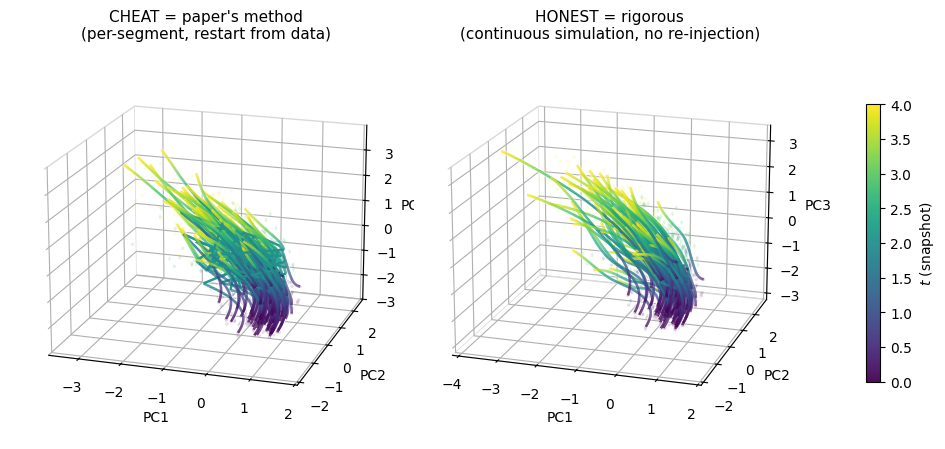
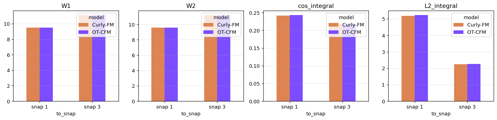

# Curly Flow Matching: trajectory inference for biological processes

Reproduction and extension of **Curly Flow Matching (Curly-FM)**, a flow-matching method that recovers rotational, non-gradient dynamics in trajectory inference.
Research project by **Wassim Abad**, EURECOM (Data Science), 2026.

> Based on the official implementation by Petrović et al.
> ([kpetrovicc/curly-flow-matching](https://github.com/kpetrovicc/curly-flow-matching), MIT License).
> Paper: *Curly Flow Matching for Learning Non-gradient Field Dynamics*, NeurIPS 2025, [arXiv:2510.26645](https://arxiv.org/abs/2510.26645).

## What this project does

Measuring a cell destroys it, so single-cell data only gives a few snapshots, taken at different times, on different cells. Trajectory inference reconstructs the path a cell follows between those snapshots.

The standard baseline (optimal-transport flow matching, **OT-CFM**) links snapshots with the straightest paths, so it cannot represent rotation or cycles. Curly-FM bends those paths so they follow a measured reference drift (for example RNA velocity).

This repository tests Curly-FM step by step, from the simplest case to real data:

| Notebook | Data | What it shows |
|---|---|---|
| [`notebooks/ocean_currents.ipynb`](notebooks/ocean_currents.ipynb) | 2-D ocean currents (paper benchmark) | Reproduction of the paper's benchmark against OT-CFM |
| [`notebooks/lotka_volterra.ipynb`](notebooks/lotka_volterra.ipynb) | Synthetic predator-prey system (purely rotational) | Drift recovery against a known ground truth |
| [`notebooks/nlsb.ipynb`](notebooks/nlsb.ipynb) | Embryoid-body scRNA-seq (NLSB dataset, real data) | Curly-FM on real cells, compared with OT-CFM |

## Main results

- **Real scRNA-seq data (NLSB):** Curly-FM cuts the direction (drift) error by almost half compared with OT-CFM, at the cost of a slight loss in distribution fidelity (Wasserstein W1). The trade-off holds across 5 training runs with different seeds. Validation hides 2 of the 5 snapshots during training.
- **Evaluation bias found in the original protocol:** trajectories were rebuilt segment by segment, restarting from the true position at each segment, which hides the accumulated error. A continuous ("honest") rollout raises the final error from 0.70 to 0.80. Both versions are reported.
- **Silent collapse fixed:** without rescaling the reference drift to the displacement scale (data-driven factor α ≈ 204 on NLSB), the geodesic loss cannot be minimised and Curly-FM silently falls back to OT-CFM's straight paths.

| Honest vs segment-wise evaluation | Metrics on NLSB |
|---|---|
|  |  |

## Setup

```bash
git clone https://github.com/s262007/curly-fm-trajectory-inference.git
cd curly-fm-trajectory-inference

python -m venv .venv
source .venv/bin/activate          # Windows: .venv\Scripts\activate

# install PyTorch first (CPU or CUDA build), then the rest
pip install torch --index-url https://download.pytorch.org/whl/cpu
pip install -r requirements.txt
pip install -e .
```

A GPU is recommended for `nlsb.ipynb` (it was trained on a Kaggle GPU) but not required. The ocean and Lotka-Volterra notebooks run on CPU.

## Data

| Notebook | Needs | Where it comes from |
|---|---|---|
| `ocean_currents` | `data/oceans/oceans.npz` | included |
| `nlsb` | `data/nlsb/{train,val,test}_rna.npz` | downloaded automatically on first run from the [NLSB repository](https://github.com/take-koshizuka/NLSB) (MIT) |
| `lotka_volterra` | `Answer/lv_train`, `Answer/lv_train_velocities.npy`, `logs/train/runs/2026-04-29_11-43-17/checkpoints/last.ckpt` | included (the notebook loads this pre-trained checkpoint) |

## Repository structure

```
notebooks/   the three notebooks above
src/         models (OT-CFM, Curly-FM and baselines), data modules, training code
configs/     Hydra configs used by src/train.py
data/        ocean data; NLSB data is downloaded on first run
Answer/      Lotka-Volterra training arrays
logs/        Lotka-Volterra checkpoint
figures/     result figures
```

## Stack

Python, PyTorch, PyTorch Lightning, torchcfm, torchdyn, torchsde, POT, NumPy, SciPy, pandas, Matplotlib, scikit-learn, Scanpy, scVelo, Hydra.

## License

MIT. The original code is © 2025 Katarina Petrovic; the modifications and new experiments are © 2026 Wassim Abad. See [LICENSE](LICENSE).
